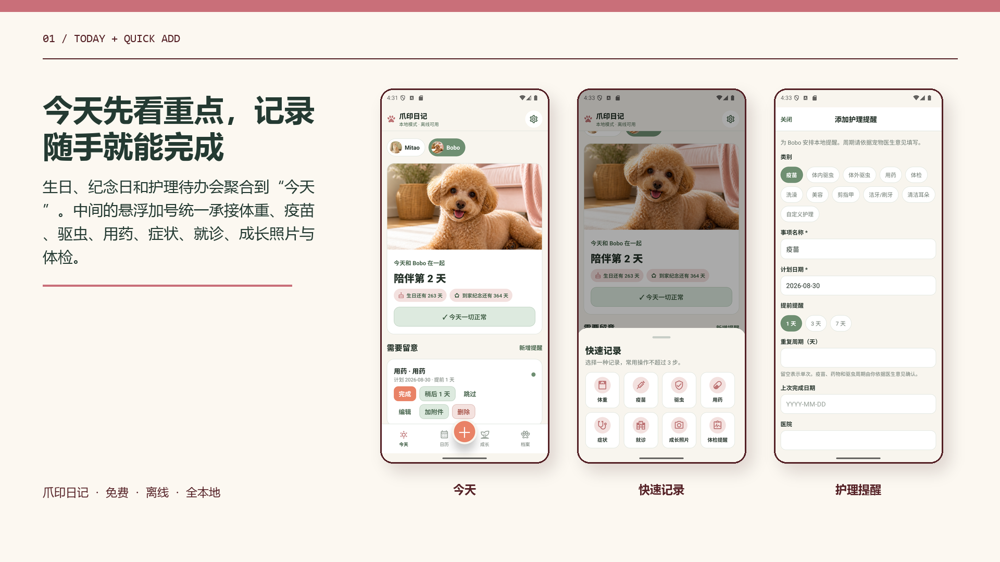
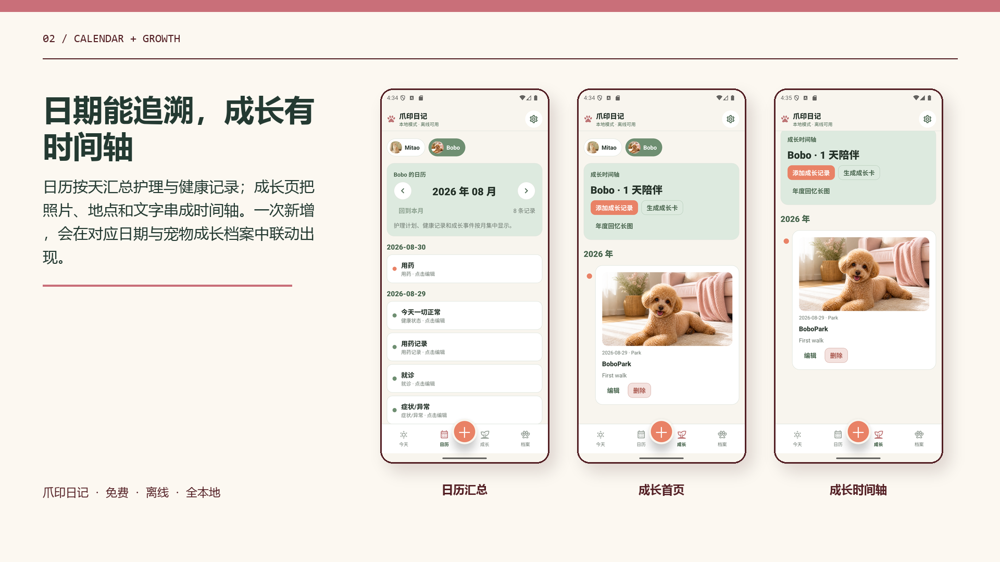
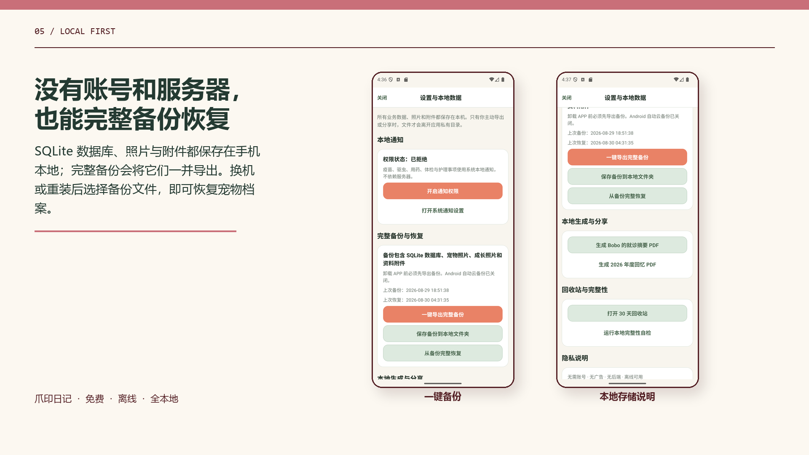

# 爪印日记 Pawprint Diary

[](https://github.com/wutao2022/pawprint-diary/actions/workflows/android-ci.yml)
[](LICENSE)
[](docs/BUILDING.md)
[](package.json)
[](tsconfig.json)

一款本地优先、离线可用的 Android 宠物健康与成长记录 APP。无需登录、无需后端，宠物档案、照片、提醒、健康记录、成长瞬间和附件均保存在手机本地，并可通过完整备份迁移到另一台设备。

> Pawprint Diary is a local-first Android app for pet care reminders, health records, growth timelines and portable backups. The UI is Chinese-first; contributions for accessibility and localization are welcome.

## 界面预览

| 今天与快速记录 | 日历与成长 |
| --- | --- |
|  |  |
| 档案与本地照片 | 完整本地备份 |
|  |  |

## 核心功能

- **四个清晰入口**：今天、日历、成长、档案，快速记录统一从悬浮 `＋` 进入。
- **多宠物独立档案**：稳定宠物 ID 隔离健康、提醒、照片、附件和成长数据，每只宠物可保存 1–5 张照片。
- **护理提醒联动**：疫苗、体内/体外驱虫、用药、体检及自定义护理；支持完成、稍后、跳过和周期续建。
- **健康与体重记录**：体重、体况、症状、食欲、饮水、排便、诊断、治疗、药物和费用。
- **成长时间轴**：按宠物记录照片、地点、文字和日期。
- **资料附件**：将图片或文件复制到应用私有目录，并与宠物或记录关联。
- **离线与隐私**：业务数据使用 SQLite；照片和附件位于应用私有文件目录；没有账号系统、广告 SDK 或业务后端。
- **完整备份与恢复**：`.pawzip` 同时包含数据库、照片和附件；恢复前校验路径、清单和数据库完整性，失败自动回滚。

## 快速开始

环境要求：Node.js 22、JDK 17、Android SDK，以及 Android 7.0（API 24）或更高版本的设备/模拟器。

```bash
git clone https://github.com/wutao2022/pawprint-diary.git
cd pawprint-diary
npm ci
npm run typecheck
npm test -- --runInBand
cd android
./gradlew assembleDebug
```

Windows PowerShell 最后一步使用：

```powershell
cd android
.\gradlew.bat assembleDebug
```

调试 APK 位于 `android/app/build/outputs/apk/debug/app-debug.apk`。正式 Release 构建需要开发者自己的签名文件，详见 [构建与签名](docs/BUILDING.md)。仓库不包含任何私钥、签名密码或用户数据。

## 项目结构

```text
.
├─ android/                 # 原生 Android 工程、Manifest、资源与 Gradle 配置
├─ assets/                  # 应用图标与启动图
├─ docs/                    # 架构、构建、测试、隐私和用户说明
├─ scripts/                 # 可复用的图标资源脚本
├─ src/
│  ├─ components/           # 共用组件与记录表单
│  ├─ data/                 # SQLite、文件系统与 Repository
│  ├─ screens/              # 四个主入口与工具页
│  ├─ services/             # 备份、通知、文档与诊断
│  └─ state/                # 应用状态和跨页面联动
├─ App.tsx                  # 应用壳、导航与浮动操作入口
└─ app.json                 # Expo/Android 权限与插件配置
```

## 文档

- [架构说明](docs/ARCHITECTURE.md)
- [构建、签名与安装](docs/BUILDING.md)
- [测试与验收边界](docs/TESTING.md)
- [隐私设计](docs/PRIVACY.md)
- [新手使用说明](docs/USER_GUIDE.md)
- [参与贡献](CONTRIBUTING.md)
- [安全策略](SECURITY.md)

## 隐私与医疗免责声明

爪印日记不主动将业务数据上传到网络，但完整备份被分享或复制出应用后，其保管责任由用户承担。本项目是记录工具，不提供兽医诊断或治疗建议；宠物出现异常时请及时联系具备资质的兽医。

## 贡献与许可证

欢迎提交 Issue 和 Pull Request。请勿在 Issue、截图、备份样本或测试夹具中上传真实个人信息、宠物病历、联系方式或签名文件。

本项目依据 [Apache License 2.0](LICENSE) 开源，第三方依赖仍遵循其各自许可证，详见 [NOTICE](NOTICE)。
